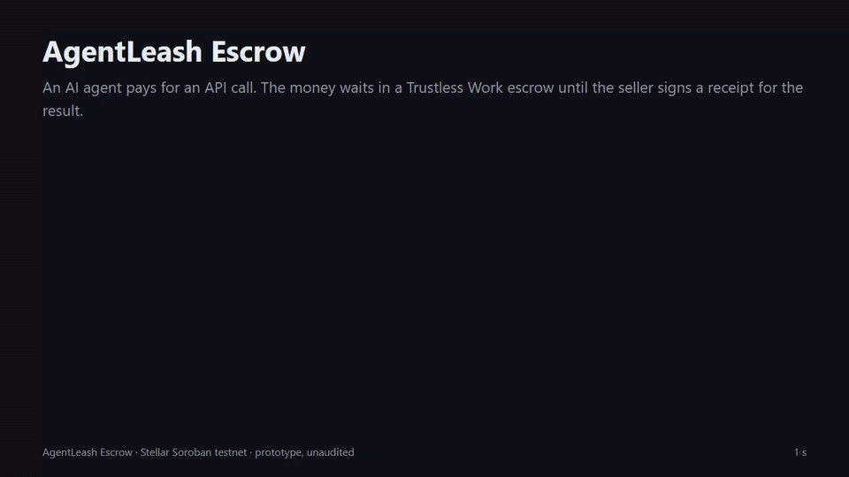

# AgentLeash Escrow (Stellar Soroban + Trustless Work)

**Status: prototype, unaudited, testnet only.** There is no mainnet configuration in this repository.

An AI agent pays sellers of paid APIs from a policy vault. The owner sets the limits; the agent can move money only
through `pay`. Every payment goes into a [Trustless Work](https://www.trustlesswork.com) single-release escrow. The
seller is paid only against an ed25519 receipt over the hash of the result it delivered; without a receipt the money
returns to the vault after the deadline.

```
owner  --set_payee / set_limits / revoke_agent / withdraw-->  LeashVault (holds the agent's USDC)
agent  --pay(seller, amount, request_hash, timeout)------->  LeashVault
          policy check -> deploy TW escrow from the pinned wasm hash -> initialize_escrow -> fund_escrow
seller --serves the call, signs receipt(vault, escrow, request_hash, result_hash)
anyone --settle(escrow, result_hash, sig)  (now <= deadline) -> TW approve_milestone + release_funds -> seller
anyone --refund(escrow)                    (now >  deadline) -> TW dispute_escrow -> LeashResolver -> resolve_dispute -> vault
```

Roles in every escrow: `approver = release_signer = platform = LeashVault`, `dispute_resolver = LeashResolver`
(a small contract that obeys only its vault — a TW resolver may not open a dispute itself),
`service_provider = receiver = seller`, `platform_fee = 0`, one milestone.

Receipt: `ed25519(seller_key, sha256("ALSH-RCPT-v1" || xdr(vault) || xdr(escrow) || request_hash || result_hash))`.
The seller's key is recorded in the payment at `pay` time, so rotating or removing the seller later does not change
which key can settle an open payment. `result_hash` is SHA-256 of the canonical JSON of the response.

## Testnet deployment (02.11.2026, the wasm built from this commit)

| | |
|---|---|
| LeashVault | [`CANKRX7T4U7PBN7SBXSJHX5Y5FKQCCWRXSHPJL6ZCJS4TILNSC6VC6RH`](https://stellar.expert/explorer/testnet/contract/CANKRX7T4U7PBN7SBXSJHX5Y5FKQCCWRXSHPJL6ZCJS4TILNSC6VC6RH) (wasm `e97a74bf…9189`, 17 000 bytes) |
| LeashResolver | [`CAH2BXINTHA5OT2Z5LGSD4QUGFUEYHR7SQEH5YA5LUXBFN7RVQHJOQ3G`](https://stellar.expert/explorer/testnet/contract/CAH2BXINTHA5OT2Z5LGSD4QUGFUEYHR7SQEH5YA5LUXBFN7RVQHJOQ3G) (wasm `184f12c8…f329`, 1 414 bytes) |
| Trustless Work escrow wasm (used by hash) | `7c3f7b2af92ad86092708b23babf80f9e1308d7f3ce18b703b9499192ecc934b` — the single-release wasm of TW escrows already live on testnet |
| Token | Circle testnet USDC, SAC `CBIELTK6YBZJU5UP2WWQEUCYKLPU6AUNZ2BQ4WWFEIE3USCIHMXQDAMA` |
| Limits | 10 USDC per call, 25 USDC per 3600 s window, agent key valid 30 days |

Flows (all transactions on stellar.expert testnet):

| Flow | Escrow | Transactions | Result |
|---|---|---|---|
| release over HTTP 402 | [`CBCA2TMI…YTDE`](https://stellar.expert/explorer/testnet/contract/CBCA2TMI5KPBQ5J4IUTUFRY7Y2R53Y7MQ2SA7EWAQLEM2BFVWQ37YTDE) | pay [`d4120cd3…b3fd`](https://stellar.expert/explorer/testnet/tx/d4120cd3fa49c028da41cee229302624f817093bfa72090a38023570e348b3fd), settle by the seller [`687007ad…3bd4`](https://stellar.expert/explorer/testnet/tx/687007ad98fbf8d28780dcb5cdf6dae7c573ed8c20da92462f02e4b8212a3bd4) | seller +1.994 of 2 USDC |
| release | [`CCTSFQVS…3NI2`](https://stellar.expert/explorer/testnet/contract/CCTSFQVSL6ML4TBHK46YALGUPG6ECBIXNO637CSPRF72ARODP2HN3NI2) | pay [`21854073…add0`](https://stellar.expert/explorer/testnet/tx/218540736f0238b88f7889f9690b1d3d0428ae338c6b4b9fa1d42dff5a35add0), settle [`5ac5d0a3…cae3`](https://stellar.expert/explorer/testnet/tx/5ac5d0a325b02916f24a0b2f1ffcc0f83c9a274fcf013b321f3dac67ca84cae3) | seller +1.994 of 2 USDC |
| refund (60 s timeout) | [`CDRZHC5Y…67VQ`](https://stellar.expert/explorer/testnet/contract/CDRZHC5YNH3MPTRE4SQGXBOSFMBLIYEP3LBQRIAYTXKCL2LA5KJP67VQ) | pay [`1a37fe0a…5d31`](https://stellar.expert/explorer/testnet/tx/1a37fe0a518ce651163fdfb2c300d4f78d68b6ff49648f9fe6b65eb339115d31), refund [`5183d063…3a04`](https://stellar.expert/explorer/testnet/tx/5183d0634362417cdd5922de87729de35cf3d9da7af28a5354ab1ff186f33a04) | vault +0.997 of 1 USDC; a valid receipt after the deadline → `Error(Contract, #11)`, after the refund → `Error(Contract, #10)` |
| forged receipts | [`CCAMTDL5…YYSG`](https://stellar.expert/explorer/testnet/contract/CCAMTDL57E4EN24KWIIXOJVEXTONVS42L35U7NKOTC7W7U5RNLX3YYSG) | pay [`f25c336d…3d11`](https://stellar.expert/explorer/testnet/tx/f25c336d6dbf93fc19b837dc896f1cd82a9e422255d77801454ba4f1f44c3d11), genuine settle [`af7fdcf5…aef0`](https://stellar.expert/explorer/testnet/tx/af7fdcf548c52196d4d9689967e22d7e5d6b3df6887abf96bfe9876c45dcaef0) | wrong key / other result hash / receipt of another escrow → `Error(Crypto, InvalidInput)`, nothing paid |
| refused | — | revoke [`a49eb9df…34ad`](https://stellar.expert/explorer/testnet/tx/a49eb9dfea0bd168cc00f3fff7dc3c7f82716f8fbe8265367db55ca3d95c34ad), restore [`53ac622b…6aa3`](https://stellar.expert/explorer/testnet/tx/53ac622b0722d8ae6ebd4866f6f4ff8f2624eb6e3a3f9e9d26e0908782576aa3) | unknown seller `#3`, over max per call `#5`, over window limit `#6`, revoked agent `#2` — the SDK refuses before signing; with `--force-chain` the contract returns the same codes |

All records: [`deployments/testnet.json`](deployments/testnet.json), Vault events exported from RPC
[`deployments/vault-events.jsonl`](deployments/vault-events.jsonl), the agent's signed action log
[`deployments/agentlog.jsonl`](deployments/agentlog.jsonl). `npm run log:verify` → `payments 5: released 3, refunded 2; agentlog 7 runs, 15 entries … verify: OK`.
Earlier deployments of the same day (before the review fixes) are kept in [`deployments/history/`](deployments/history/).
A refund is counted separately from a release: it is not a completed sale. Demo video (66 s): [`video/demo.mp4`](video/demo.mp4), 

## Tests

- `cargo test --workspace` — **43 passed** (Rust, against the real Trustless Work wasm in the Soroban test env;
  authorization is enforced: no blanket auth mocks in the flows, only the agent's or owner's signature on the outer call). Covers every policy refusal, window and
  deadline boundaries, replayed / late / forged receipts, settle after refund and the reverse, seller-opened disputes,
  the resolver refusing anyone but its vault, the seller unable to approve or release its own payment, overflow of the
  window sum, events.
- `npm test` — **16 passed** (receipt digest vector shared with the Rust test, pre-sign policy, agent log tamper checks).
- CI: GitHub Actions on Ubuntu — tests, clippy `-D warnings`, wasm build, gitleaks over the full history,
  `cargo deny check licenses` and `license-checker` (permissive licenses only), no wasm in git.

## Review

- Jules (Google) review of the contracts and scripts: 1 medium (unchecked window addition trapped instead of refusing),
  4 low. Fixed with a failing test first: the medium, resolver TTL at deploy, withdraw of a non-positive amount,
  read-only simulations without the secret key. Not changed: `set_limits` with a shorter period ends the current window
  early — only the owner can do it, and resetting the window there would also hand out a fresh budget.
- A second model (Gemini) was asked the same questions; its two "high" findings (missing sub-call authorization, fee
  breaking `resolve_dispute`) are disproved by the auth-enforced tests and by the testnet transactions above.

## Run it

```sh
sh scripts/fetch-tw-wasm.sh                       # TW escrow wasm from testnet by hash (not committed)
cargo test --workspace
stellar contract build --package leash-resolver && stellar contract build --package leash-vault
npm ci && npm test
export AL_KEYS_FILE=/path/outside/repo/keys.json  # {"keys":{"al-owner":{public,secret},"al-agent":…,"al-seller":…}}
npm run deploy:testnet
npm run demo:release402 && npm run demo:release && npm run demo:refund && npm run demo:refused && npm run demo:forged
npm run log:export && npm run log:verify
```

## Try it with your own keys (testnet, about 5 minutes, no Rust)

One command runs a full session on Stellar **testnet** with keys made on your machine: your own LeashVault and
LeashResolver are deployed from the wasm already uploaded to testnet (the code of commit `250a428`), then one payment
is released to the seller against its signed receipt over HTTP 402, and one is refunded because the seller stays
silent past a 60-second deadline. Every transaction is signed by your keys; nothing touches mainnet or real money.

Needs: Node 24, git, [stellar-cli](https://developers.stellar.org/docs/tools/cli) 28.x on `PATH` (or `STELLAR_BIN`).

```sh
git clone https://github.com/ttimesai-star/agentleash-escrow && cd agentleash-escrow
npm ci
npm run try        # keys -> friendbot XLM -> testnet USDC from the DEX -> deploy -> release402 -> refund
```

What it does, step by step (`scripts/try-it.ts`):

1. Makes three new testnet keys (owner, agent, seller) in `~/.agentleash/testnet-keys.json` (override with
   `AL_KEYS_FILE`; never written into the repo) and funds them with friendbot.
2. Adds a USDC trustline for owner and seller; the owner buys 60 testnet USDC (Circle) for about 75 testnet XLM on the
   testnet DEX (path payment, capped at 250 XLM).
3. Deploys your vault (limits 10 USDC per call, 25 USDC per hour), allow-lists your seller, funds the vault.
4. `release402`: the seller answers `402` with its terms, the agent pays into a Trustless Work escrow through the
   vault, the seller checks the escrow on chain, serves, and settles with its receipt (+1.994 of 2 USDC; TW keeps 0.3%).
5. `refund`: the agent pays 1 USDC with a 60 s deadline, the seller is silent, a late receipt is refused (`#11`), the
   refund returns 0.997 USDC to the vault, and a receipt after the refund is refused (`#10`).

At the end it prints stellar.expert links to your transactions. Sharing is optional: if you are willing, open an
issue titled "Testnet session" with your vault address (public testnet data). Problems and confusing steps are just as
useful: open an issue with the output. The run overwrites `deployments/testnet.json` in your clone
(`git checkout deployments/testnet.json` restores ours).

## Known limits (honest list)

- **Fees:** Trustless Work keeps 0.3% on both paths — a refund returns 99.7%. `platform_fee` is 0.
- One escrow contract is deployed per payment (fine on testnet; on mainnet a pooled or multi-release design is the
  next step). The window limit counts money sent out; a refund does not restore it (conservative by design).
- `release_funds` / `resolve_dispute` take the TW fee address from the caller; the vault passes a pinned address
  (`GA6KH5VW…CK7G`, the receiver seen in TW testnet releases).
- Not done yet: the escrows are not registered in the TW indexer/API (needs a TW API key); OpenZeppelin smart accounts
  for the agent key are out of scope.
- Storage TTL: the vault and resolver extend their instance on use (30 days); a vault idle for longer needs a
  ledger-entry restore before the next call.
- The demo seller runs in the same process as the agent (over real HTTP on localhost) — no external pilot users yet.
- No external audit. Do not use with real funds.

License: MIT. The Trustless Work escrow contract is not included; this project only calls it by its on-chain hash.
